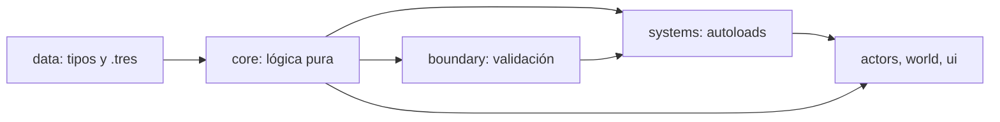

# Arquitectura de Dead Shift 3D

Dead Shift 3D está hecho con Godot 4.7.2 (edición estándar) y GDScript con tipado estático. Se publica solo como export web de un solo hilo, con el renderer Compatibility (WebGL 2), así que funciona en hosting estático y dentro de un iframe, sin cabeceras especiales. Este documento describe cómo está organizado el código hoy, en el corte jugable de la planta baja.

## Mapa de carpetas

```
game/
  core/        lógica pura del juego, sin escenas ni nodos (se prueba sin motor gráfico)
  data/        tipos de datos, sus .tres (objetos, recetas, enemigos, pisos), reglas y textos
  boundary/    validation.gd: validación de todo lo que entra desde fuera
  systems/     autoloads (servicios globales) registrados en project.godot
  actors/      jugador (player/) y enemigos (enemies/)
  world/       kit modular, construcción del piso, objetos, contenedores y botín
  ui/          HUD, controles táctiles, mochila, pausa, fin y rendimiento
  game.gd      partida en curso: monta el piso y la interfaz
  main.gd      pantalla de inicio con el aviso de contenido
addons/gut/    framework de pruebas (solo desarrollo, no se exporta)
tests/         unit/, integration/, bot/ (recorrido automático), capture/ (capturas)
tools/         verify.ps1, web_smoke.py, requirements.txt
web/           página HTML propia del export (shell.html, boot.js, boot.css)
docs/          documentación pública
```

## Capas y dependencias



- **`core/`** contiene las reglas: desgaste de armas y chalecos (`durability.gd`), inventario limitado (`inventory.gd`), recetas de dos objetos (`crafting.gd`), uso de armas (`weapon_use.gd`), daño (`damage_model.gd`, `enemy_health.gd`), botín (`loot_roller.gd`), ruido (`noise_model.gd`), estado del jugador (`player_state.gd`) y códec del guardado (`save_codec.gd`). Son clases `RefCounted` que no conocen el árbol de escenas: reciben datos y devuelven resultados. El azar se inyecta como `RandomNumberGenerator` con semilla, así que todo es reproducible en pruebas.
- **`data/`** define los tipos (`ItemData`, `WeaponData`, `VestData`, `RecipeData`, `EnemyData`, `FloorData`…) y los valores concretos en archivos `.tres`. `catalog.tres` registra en un solo lugar todos los objetos, recetas y enemigos. `rules.gd` reúne las constantes compartidas y `texts/texts.csv` todos los textos visibles por clave.
- **`systems/`** son los autoloads, en este orden: `Config` (plataforma y parámetros de la dirección), `ErrorLog` (registro central de errores), `EventBus` (señales entre nodos), `SaveStore` (único acceso al almacenamiento), `Settings` (ajustes y calidad gráfica), `GameState` (partida y pausa), `NoiseSystem` (ruidos del juego) e `InputRouter` (única entrada de controles).
- **`actors/`, `world/` y `ui/`** son la presentación: escenas y nodos que leen el estado, piden cambios a la lógica y se comunican por `EventBus`, sin buscarse unos a otros por rutas.

## Flujo principal

1. `main.gd` muestra el nombre, el aviso de contenido y «Jugar». Ese toque o clic es el gesto que el navegador exige para capturar el puntero.
2. `game.gd` reinicia el estado del jugador, crea el piso (`FloorLevel`) y monta la interfaz.
3. `FloorLevel` construye la planta baja desde `data/floors/ground_floor.tres`: cada sala (`RoomData`) se arma con el kit de `world/kit.gd`, se coloca el botín, se hornea la navegación de los enemigos, se crean los enemigos, el jugador y la salida a la escalera.
4. Durante la partida, el jugador (`actors/player/`) lee controles de `InputRouter`, el combate y la combinación de objetos aplican las reglas de `core/`, y los cambios se anuncian por `EventBus` para que el HUD y la mochila se actualicen.
5. La partida termina al morir o al llegar a la escalera, con una pantalla de estadísticas y «Jugar de nuevo».

## Decisiones de diseño

- **Lógica separada de la presentación.** Las reglas viven en `core/` para probarlas sin abrir el juego; la escena solo las aplica.
- **Todo por datos.** Armas, objetos, recetas, enemigos y pisos son recursos `.tres`; los textos son claves de traducción. Ajustar el balance o añadir contenido no requiere tocar la lógica.
- **Controles por acciones.** El juego solo lee acciones del InputMap a través de `InputRouter`. El teclado, el ratón y los controles táctiles (`ui/touch_controls.gd`) son traductores a esas acciones, así que un mando futuro no cambiaría la lógica. En táctil hay una ayuda de puntería suave, que se puede desactivar.
- **Pisos construidos al cargar.** Un piso es una lista de salas con puertas, escaparates y botín. El kit funde las piezas de cada sala en una sola malla por material para reducir las llamadas de dibujo.
- **Pensado para web.** Un solo hilo, sin peticiones de red y sin recursos de terceros en tiempo de ejecución. La página `web/shell.html` no tiene scripts en línea: `boot.js` arranca el motor, lo que permite una política de seguridad de contenido estricta.
- **Accesibilidad desde el principio.** Botones táctiles de 44 px como mínimo dentro del área segura de la pantalla; el desgaste se muestra con un icono de forma y texto, no solo con color; el aviso de daño se desvanece sin destellos; el disparo nunca produce más de 3 destellos por segundo.

## Datos y seguridad

El juego corre entero en el dispositivo del jugador y no tiene servidor ni cuentas. Todo lo que llega desde fuera (ajustes y partida guardados en el navegador, y el parámetro `seed` de la dirección) pasa por `boundary/validation.gd`: se comprueban tipos, rangos, longitudes y formatos por lista blanca, y lo dañado o manipulado vuelve a su valor por defecto en lugar de romper el juego. Los datos guardados son JSON con número de versión; nunca se cargan recursos del motor desde datos externos. Los errores se anotan en un registro interno y al jugador solo se le muestra un mensaje general.

## Cómo se prueba

- **Tests unitarios** (`tests/unit/`, con GUT): todas las reglas de `core/`, la coherencia de los datos y entradas hostiles (guardados truncados, gigantes, con tipos erróneos o de una versión futura; semillas inválidas). Un test carga todos los scripts y escenas para detectar errores de compilación.
- **Tests de integración** (`tests/integration/`): escenas mínimas donde el jugador se mueve solo con acciones, un caminante lo alcanza y le hace daño, un policía muerto deja botín, un arma se rompe en pleno golpe y una combinación tarda, hace ruido y deja al jugador indefenso.
- **Bot de recorrido** (`tests/bot/`): juega la planta baja con semilla fija y sin ventana, y debe llegar a la escalera. Demuestra que el piso se puede completar, no que sea divertido.
- **Prueba de humo** (`tools/web_smoke.py`): abre el export en Chromium por dirección directa, dentro de un iframe de otro origen y con táctil emulado; falla ante errores de consola, violaciones de la política de contenido o peticiones a otros dominios.
- **Capturas** (`tests/capture/`): recorren 5 puntos fijos para revisar que no haya errores visibles.

`tools/verify.ps1` reúne todo (ver el README). La sensación de control, el aspecto y el rendimiento en cada dispositivo se revisan a mano.

## Cómo se extiende

- **Un arma u objeto nuevo:** un `.tres` en `data/items/` (con su `WeaponData` si es un arma), su clave de texto en `texts.csv` y su entrada en `catalog.tres`.
- **Una receta:** un `.tres` en `data/recipes/` con los dos objetos y el resultado, añadido a `catalog.tres`. Las reparaciones usan `repair_fraction`.
- **Un enemigo:** un `.tres` en `data/enemies/` y, si se comporta distinto, un script que herede de `EnemyBehavior`, registrado en `actors/enemies/enemy_behaviors.gd`. La máquina de estados común (`enemy.gd`) no se copia.
- **Una tienda o sala:** una `RoomData` más en el `FloorData` del piso, con sus puertas, su escaparate y sus puntos de botín.

## Límites conocidos

- El arte es provisional y todavía no hay sonido ni guardado de partida.
- iOS Safari no está probado en un dispositivo real.
- Cuando el juego tiene el foco, el motor recibe todas las teclas, incluidas algunas del navegador como F5.
