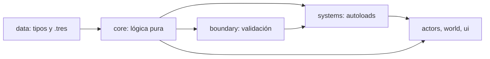

# Arquitectura de Dead Shift 3D

Dead Shift 3D está hecho con Godot 4.7.2 (edición estándar) y GDScript con tipado estático. Se publica solo como export web de un solo hilo, con el renderer Compatibility (WebGL 2), así que funciona en hosting estático y dentro de un iframe, sin cabeceras especiales. Este documento describe cómo está organizado el código hoy: el juego completo con arte provisional.

## Mapa de carpetas

```
game/
  core/        lógica pura del juego, sin escenas ni nodos (se prueba sin motor gráfico)
  data/        tipos de datos, sus .tres (objetos, recetas, enemigos, pisos), reglas y textos
  boundary/    validación de todo lo que entra desde fuera (ajustes, partida guardada, URL)
  systems/     autoloads (servicios globales) registrados en project.godot
  actors/      jugador (player/) y enemigos (enemies/), con el jefe
  world/       kit modular, construcción del piso, objetos, contenedores, rejas, salidas,
               accesorios del almacén, nube tóxica, oleadas y helicóptero
  ui/          HUD, controles táctiles, mochila, mapa, opciones, pausa, carga y fin
  game.gd      partida en curso: pisos, cambio de piso, reloj del rescate, guardado y desenlaces
  main.gd      menú principal: continuar, nueva partida, opciones y borrar datos
addons/gut/    framework de pruebas (solo desarrollo, no se exporta)
tests/         unit/, integration/, bot/ (recorridos automáticos), capture/ (capturas)
tools/         verify.ps1, web_smoke.py, requirements.txt
web/           página HTML propia del export (shell.html, boot.js, boot.css)
docs/          documentación pública
```

## Capas y dependencias



- **`core/`** contiene las reglas: desgaste (`durability.gd`), inventario (`inventory.gd`), recetas (`crafting.gd`), armas (`weapon_use.gd`), daño (`damage_model.gd`, `enemy_health.gd`), botín (`loot_roller.gd`), ruido y lo que recuerda un enemigo que oye (`noise_model.gd`, `hearing.gd`), dirección de los subtítulos (`sound_direction.gd`), infección (`infection.gd`), estado del jugador y sus objetos clave (`player_state.gd`, `key_items.gd`), estado del mundo entre pisos (`world_state.gd`), reglas del jefe (`boss_model.gd`), reloj del rescate (`rescue_clock.gd`), estadísticas y nota (`run_stats.gd`), y guardado (`save_codec.gd`, `save_game.gd`). Son clases `RefCounted` que no conocen el árbol de escenas: reciben datos y devuelven resultados. El azar y el tiempo se inyectan (`RandomNumberGenerator` con semilla, `tick(delta)`), así que todo es reproducible en pruebas.
- **`data/`** define los tipos (`ItemData`, `WeaponData`, `EnemyData`, `BossData`, `FloorData`, `RoomData`, `FloorExit`, `GateSpec`, `PropSpec`…) y los valores concretos en `.tres`. `catalog.tres` registra en un solo lugar objetos, recetas, enemigos y pisos. `rules.gd` reúne las constantes compartidas y `texts/texts.csv` todos los textos visibles por clave.
- **`boundary/`**: `validation.gd` (ajustes, teclas reasignadas y parámetros de la dirección) y `save_validation.gd` (partida guardada).
- **`systems/`** son los autoloads, en este orden: `Config` (plataforma y parámetros de la dirección), `ErrorLog` (registro central de errores), `EventBus` (señales entre nodos), `SaveStore` (único acceso al almacenamiento), `Settings` (ajustes), `AudioDirector` (canales y volúmenes), `GameState` (partida, mundo, rescate, semilla y pausa), `NoiseSystem` (ruidos del juego) e `InputRouter` (única entrada de controles y teclas reasignadas).
- **`actors/`, `world/` y `ui/`** son la presentación: escenas y nodos que leen el estado, piden cambios a la lógica y se comunican por `EventBus`.

## Flujo principal

1. `main.gd` muestra el nombre, el aviso de contenido y el menú. «Continuar» solo aparece si hay una partida guardada que se puede leer. El toque o clic en un botón es el gesto que el navegador exige para capturar el puntero.
2. `game.gd` empieza una partida nueva o retoma la guardada y crea el piso (`FloorLevel`) con la interfaz.
3. `FloorLevel` construye el piso desde su `FloorData`: cada sala se arma con el kit de `world/kit.gd`; se colocan botín, accesorios, rejas, salidas y enemigos; se hornea la navegación; y se respeta el estado del mundo (lo muerto sigue muerto, lo recogido no vuelve, lo registrado sigue vacío y lo que quedó en el suelo reaparece).
4. Al entrar en una salida, `game.gd` muestra la pantalla de carga, guarda lo que quedó en el suelo, destruye el piso, construye el siguiente y coloca al jugador en la salida enlazada. El jugador y el mundo viven en `GameState`, no en el piso.
5. Con las tres piezas, el jugador arma el teléfono y llama al helicóptero cuando quiere. `game.gd` avanza el reloj del rescate fuera de la pausa. Si el jugador está en el helipuerto de la azotea mientras el helicóptero espera, es rescatado; si el helicóptero se va sin él, la azotea recibe oleadas con un tope de enemigos a la vez.
6. La partida termina con un desenlace (rescate, rescate perdido, muerte o conversión), sus estadísticas y la nota.

## Guardado

Una sola ranura en el almacenamiento del navegador. Se guarda automáticamente al entrar en una zona segura y al terminar un cambio de piso, y a mano desde la pausa en una zona segura. El formato es JSON con número de versión (`core/save_codec.gd`) y una cadena de migraciones desde versiones anteriores. Al cargar, `boundary/save_validation.gd` revisa cada campo y la coherencia entre campos (el piso y el punto de reaparición existen, el inventario cabe y no repite casillas, las piezas no se repiten, el teléfono solo está armado con todas sus piezas, el reloj nunca es negativo…) y corrige o descarta lo inválido. Así, un guardado dañado o manipulado nunca deja la partida en un estado imposible. Los ajustes y la mejor nota tienen su propio formato.

## Decisiones de diseño

- **Lógica separada de la presentación.** Las reglas viven en `core/` para probarlas sin abrir el juego; la escena solo las aplica.
- **Todo por datos.** Armas, objetos, recetas, enemigos (y el jefe), pisos, salidas, rejas y accesorios son recursos `.tres`; los textos son claves de traducción.
- **Comportamientos de enemigos intercambiables.** Una máquina de estados común (`enemy.gd`) y un comportamiento por tipo (`actors/enemies/behaviors/`) que decide a dónde ir y cuándo puede atacar. El oyente reacciona a los ruidos según su sensibilidad; el acechador rodea al jugador y solo ataca por el flanco. El jefe hereda de la misma base con su propia secuencia.
- **Controles por acciones.** El juego solo lee acciones del InputMap a través de `InputRouter`. El teclado, el ratón y los controles táctiles traducen a esas acciones; las teclas se reasignan cambiando solo los eventos de teclado.
- **Se puede jugar sin sonido.** Cada sonido importante emite un aviso con su dirección que se muestra como subtítulo; el ruido propio y la cercanía del jefe tienen indicadores con forma y texto.
- **Pensado para web.** Un solo hilo, sin peticiones de red y sin recursos de terceros en tiempo de ejecución. La página `web/shell.html` no tiene scripts en línea, lo que permite una política de seguridad de contenido estricta.
- **Accesibilidad desde el principio.** Botones táctiles de 44 px como mínimo dentro del área segura; opciones con botones «−» y «+» que funcionan igual con teclado, ratón y toque; información que no depende solo del color; nada parpadea más de 3 veces por segundo; «Reducir movimiento», «Reducir destellos» y «Reducir sangre».

## Datos y seguridad

El juego corre entero en el dispositivo del jugador y no tiene servidor ni cuentas. Todo lo que llega desde fuera (ajustes, teclas, partida y mejor nota guardadas en el navegador, y el parámetro `seed` de la dirección) pasa por `boundary/`: tipos, rangos, longitudes y formatos por lista blanca, con límites de tamaño y profundidad. Lo dañado vuelve a su valor por defecto en lugar de romper el juego. Nunca se cargan recursos del motor desde datos externos. Los errores se anotan en un registro interno y al jugador solo se le muestra un mensaje general.

## Cómo se prueba

- **Tests unitarios** (`tests/unit/`, con GUT): todas las reglas de `core/` (incluidos el reloj del rescate por todos sus caminos, la infección, el jefe y la nota), la coherencia de los datos (pisos enlazados, dos dosis de Neutrax en todo el juego, cartuchos casi justos para el jefe) y entradas hostiles (guardados truncados, gigantes, con tipos erróneos, incoherentes o de una versión futura; un guardado antiguo migrado; teclas reservadas o repetidas; semillas inválidas).
- **Tests de integración** (`tests/integration/`): escenas mínimas y partidas completas sin ventana: un objeto lanzado atrae a un oyente y no a un caminante, el acechador no ataca de frente, el jefe se aturde con un tablero y suelta la llave, el estado se conserva al cambiar de piso, el guardado se retoma, los desenlaces y las opciones se aplican y se conservan.
- **Bot de recorrido** (`tests/bot/`): juega sin ventana con semillas fijas a través de las acciones del InputMap. Completa la partida hasta el rescate con varias semillas, vence al jefe con y sin escopeta y llega a los finales de rescate perdido y de muerte. Demuestra que el juego se puede completar, no que sea divertido.
- **Prueba de humo** (`tools/web_smoke.py`): abre el export en Chromium por dirección directa, dentro de un iframe de otro origen y con táctil emulado; falla ante errores de consola, violaciones de la política de contenido o peticiones a otros dominios.
- **Capturas** (`tests/capture/`): recorren puntos fijos de todos los pisos para revisar que no haya errores visibles y medir el rendimiento.

`tools/verify.ps1` reúne todo (ver el README). La sensación de control, el aspecto, la dificultad y el rendimiento en cada dispositivo se revisan a mano.

## Cómo se extiende

- **Un arma u objeto nuevo:** un `.tres` en `data/items/` (con su `WeaponData` si es un arma), su clave de texto en `texts.csv` y su entrada en `catalog.tres`.
- **Una receta:** un `.tres` en `data/recipes/` con los dos objetos y el resultado, añadido a `catalog.tres`.
- **Un enemigo:** un `.tres` en `data/enemies/` y, si se comporta distinto, un script que herede de `EnemyBehavior` registrado en `actors/enemies/enemy_behaviors.gd`.
- **Una tienda, una reja o una salida:** una `RoomData`, `GateSpec` o `FloorExit` más en el `FloorData` del piso.
- **Un campo nuevo en el guardado:** súbelo en `SaveGame`, valídalo en `save_validation.gd` y, si cambia el formato, sube la versión en `save_codec.gd` con su paso de migración y su test.

## Límites conocidos

- El arte es provisional y todavía no hay sonidos (los canales y volúmenes ya existen).
- La semilla de la partida hoy solo decide el azar de los contagios; el reparto aleatorio de objetos llegará más adelante.
- iOS Safari no está probado en un dispositivo real.
- Cuando el juego tiene el foco, el motor recibe todas las teclas, incluidas algunas del navegador como F5.
