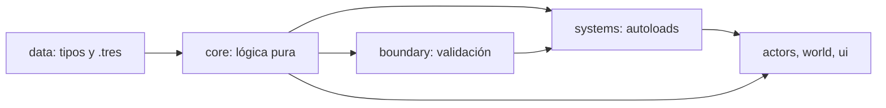

# Arquitectura de Dead Shift 3D

Dead Shift 3D está hecho con Godot 4.7.2 (edición estándar) y GDScript con tipado estático. Se publica solo como export web de un solo hilo, con el renderer Compatibility (WebGL 2), así que funciona en hosting estático y dentro de un iframe, sin cabeceras especiales. Este documento describe cómo está organizado el código hoy: el juego completo, con su arte, sonido, intro y final.

## Mapa de carpetas

```
game/
  core/        lógica pura del juego, sin escenas ni nodos (se prueba sin motor gráfico)
  data/        tipos de datos, sus .tres (objetos, recetas, enemigos, pisos), reglas y textos
  boundary/    validación de todo lo que entra desde fuera (ajustes, partida guardada, URL)
  systems/     autoloads (servicios globales) registrados en project.godot
  actors/      jugador (player/) y enemigos (enemies/), con el jefe
  world/       edificio y pisos (kit modular con superficies de textura, escaleras, huecos y
               barandillas), objetos, contenedores, rejas, accesorios, cristales que se rompen,
               nota del técnico, monitores, nube tóxica, oleadas, helicóptero, modelos de
               armas y objetos, mobiliario que se coloca por código (baños, escaparates de las
               tiendas cerradas y desorden por el suelo) y efectos de impacto
  ui/          HUD, controles táctiles, mochila (con iconos, bolsa y cuaderno), panel de
               curación, mapa, nota, visor de cámaras, consejos, opciones, pausa, intro,
               escena final, créditos, privacidad y términos, aviso de girar el celular, fin
               y el tema común de la interfaz
  game.gd      partida en curso: edificio, reloj del rescate, oleadas, guardado y desenlaces
  main.gd      menú principal: continuar, nueva partida, opciones, borrar datos, créditos,
               privacidad y términos
assets/
  third_party/ recursos CC0 de terceros tal como se descargaron (texturas, personajes,
               animaciones y sonidos), con su licencia, origen y huellas; no se importan
  generated/   lo que generan los scripts de tools/blender: textura de superficies, mobiliario,
               armas y objetos, brazos, enemigos, personas de la intro y vehículos
  audio/       sonidos y música en WAV (Godot los comprime al importar)
addons/gut/    framework de pruebas (solo desarrollo, no se exporta)
tests/         unit/, integration/, bot/ (recorridos automáticos), capture/ (capturas)
tools/         verify.ps1, web_smoke.py, third_party_manifest.py, notices.gd (aviso de
               licencias que se publica junto al juego), requirements.txt y blender/
               (scripts que generan el arte y el sonido de assets/generated y audio/)
.github/       flujo que prueba, exporta y publica el juego en GitHub Pages
web/           página HTML propia del export (shell.html, boot.js, boot.css)
docs/          documentación pública
```

## Capas y dependencias



- **`core/`** contiene las reglas: desgaste (`durability.gd`), inventario y bolsa de materiales (`inventory.gd`, `material_bag.gd`), recetas (`crafting.gd`), dificultad (`difficulty.gd`), linterna (`flashlight.gd`), armas (`weapon_use.gd`), daño (`damage_model.gd`, `enemy_health.gd`), botín (`loot_roller.gd`), ruido y lo que recuerda un enemigo que oye (`noise_model.gd`, `hearing.gd`), dirección de los subtítulos (`sound_direction.gd`), infección (`infection.gd`), estado del jugador y sus objetos clave (`player_state.gd`, `key_items.gd`), estado del mundo entre pisos (`world_state.gd`), reglas del jefe (`boss_model.gd`), animaciones de los brazos en primera persona como datos (`arm_animations.gd`), alcance de un brazo de dos huesos y movimiento de las manos al combinar (`arm_reach.gd`, `craft_motion.gd`), topes de los efectos de impacto y «Reducir sangre» (`gore_budget.gd`), reparto del botín según la semilla (`loot_plan.gd`), reloj del rescate (`rescue_clock.gd`), objetivo actual (`objectives.gd`), lo que el jugador ya descubrió (`discovery.gd`), dónde están las cosas importantes para el mapa (`map_markers.gd`), cámaras de seguridad (`camera_spots.gd`), trozos de los cristales rotos (`glass_shards.gd`), consejos de primera vez (`tips.gd`), curación rápida (`quick_heal.gd`), estadísticas y nota (`run_stats.gd`), y guardado (`save_codec.gd`, `save_game.gd`). `crafting.gd` además lista las combinaciones posibles con lo que se lleva y lo que falta para otras. Son clases `RefCounted` que no conocen el árbol de escenas: reciben datos y devuelven resultados. El azar y el tiempo se inyectan (`RandomNumberGenerator` con semilla, `tick(delta)`), así que todo es reproducible en pruebas.
- **`data/`** define los tipos (`ItemData`, `WeaponData`, `EnemyData`, `BossData`, `DifficultyData`, `FloorData`, `RoomData`, `RampSpec`, `FloorExit`, `GateSpec`, `PropSpec`…) y los valores concretos en `.tres`. `catalog.tres` registra en un solo lugar objetos, recetas, enemigos, pisos y dificultades. Los accesorios de un piso (`PropSpec`) pueden ser decorado, estanterías, tableros, monitores, la nota del técnico o cámaras de seguridad. `rules.gd` reúne las constantes compartidas y `texts/texts.csv` todos los textos visibles por clave.
- **`boundary/`**: `validation.gd` (ajustes, teclas reasignadas y parámetros de la dirección) y `save_validation.gd` (partida guardada).
- **`systems/`** son los autoloads, en este orden: `Config` (plataforma y parámetros de la dirección), `ErrorLog` (registro central de errores), `EventBus` (señales entre nodos), `SaveStore` (único acceso al almacenamiento), `Settings` (ajustes), `AudioDirector` (canales, volúmenes, sonidos con variantes, ambiente de cada piso y música según la situación), `GameState` (partida, mundo, rescate, semilla y pausa), `NoiseSystem` (ruidos del juego) e `InputRouter` (única entrada de controles y teclas reasignadas).
- **`actors/`, `world/` y `ui/`** son la presentación: escenas y nodos que leen el estado, piden cambios a la lógica y se comunican por `EventBus`.

## Flujo principal

1. `main.gd` muestra el nombre, el aviso de contenido y el menú. «Continuar» solo aparece si hay una partida guardada que se puede leer. El toque o clic en un botón es el gesto que el navegador exige para capturar el puntero. Una partida nueva empieza con la intro (`ui/intro.gd`), que se puede saltar; al terminar, la partida arranca con el guardia despertando ante los monitores de la sala de seguridad.
2. `game.gd` empieza una partida nueva o retoma la guardada y crea el edificio (`Building`) con la interfaz.
3. `Building` apila los cuatro pisos (`FloorSection`) a su altura. Cada piso se construye desde su `FloorData`: forjados con huecos (atrio y escaleras), salas con el kit de `world/kit.gd`, escaleras que se suben caminando, barandillas, decorado y mobiliario (todas las piezas de una sala, con sus texturas, modelos y paneles de luz, en una sola superficie que elige la textura y el tono por vértice, para no sumar llamadas de dibujo), cristales de escaparate (que se pueden romper), botín (repartido según la semilla de la partida), accesorios y rejas; se respeta el estado del mundo (lo muerto sigue muerto, lo recogido no vuelve, lo registrado sigue vacío y lo que quedó en el suelo reaparece). Se hornea una sola navegación para todo el edificio, así los enemigos también suben escaleras.
4. El piso del jugador se deduce de su altura. Al cambiar de piso se autoguarda en el descansillo más cercano; solo el piso actual y los contiguos tienen enemigos activos y geometría visible, para el rendimiento (mientras se mira una cámara de seguridad, también se ve su piso). El jugador y el mundo viven en `GameState`. Al empezar la pelea, el jefe corta la energía de su piso: las luces bajan poco a poco hasta las de emergencia y vuelven al vencerlo.
5. Con las tres piezas, el jugador arma el teléfono (con las manos durante unos segundos, como al combinar: hace ruido y no puede atacar) y llama al helicóptero cuando quiere. `game.gd` avanza el reloj del rescate fuera de la pausa; mientras se espera, la llamada atrae oleadas cortas a la azotea. Si el jugador está en el helipuerto mientras el helicóptero espera, es rescatado; si el helicóptero se va sin él, llegan las oleadas del rescate perdido, con un tope de enemigos a la vez.
6. La partida termina con un desenlace (rescate, rescate perdido, muerte o conversión). El rescate y el rescate perdido tienen una escena corta (`ui/outro.gd`); las estadísticas, la nota y los créditos aparecen encima de esa escena mientras el helicóptero se aleja.

## Guardado

Una sola ranura en el almacenamiento del navegador (IndexedDB), dentro de una carpeta propia del juego: en la web, ese almacenamiento es común a todos los juegos hechos con el mismo motor en el mismo dominio. Se guarda automáticamente al entrar en una zona segura y al pasar a otro piso, y a mano desde la pausa en una zona segura. El formato es JSON con número de versión (`core/save_codec.gd`) y una cadena de migraciones desde versiones anteriores. La partida guarda también la dificultad, la bolsa de materiales, la carga de la linterna, los cristales rotos y las marcas del mundo (rejas abiertas, lo descubierto y los consejos ya vistos). Al cargar, `boundary/save_validation.gd` revisa cada campo y la coherencia entre campos (el piso y el punto de reaparición existen, el inventario cabe y no repite casillas (la porra va en una posición fija que no ocupa casilla), las piezas no se repiten, el teléfono solo está armado con todas sus piezas, el reloj nunca es negativo…) y corrige o descarta lo inválido. Así, un guardado dañado o manipulado nunca deja la partida en un estado imposible. Los ajustes y la mejor nota tienen su propio formato.

## Decisiones de diseño

- **Lógica separada de la presentación.** Las reglas viven en `core/` para probarlas sin abrir el juego; la escena solo las aplica.
- **Todo por datos.** Armas, objetos, recetas, enemigos (y el jefe), pisos, salidas, rejas y accesorios son recursos `.tres`; los textos son claves de traducción.
- **Comportamientos de enemigos intercambiables.** Una máquina de estados común (`enemy.gd`) y un comportamiento por tipo (`actors/enemies/behaviors/`) que decide a dónde ir y cuándo puede atacar. El oyente reacciona a los ruidos según su sensibilidad; el acechador rodea al jugador y solo ataca por el flanco. El jefe hereda de la misma base con su propia secuencia.
- **Controles por acciones.** El juego solo lee acciones del InputMap a través de `InputRouter`. El teclado, el ratón y los controles táctiles traducen a esas acciones; las teclas se reasignan cambiando solo los eventos de teclado.
- **Se puede jugar sin sonido.** Cada sonido importante emite un aviso con su dirección que se muestra como subtítulo; el ruido propio y la cercanía del jefe tienen indicadores con forma y texto.
- **Pensado para web.** Un solo hilo, sin peticiones de red y sin recursos de terceros en tiempo de ejecución. La página `web/shell.html` no tiene scripts en línea, lo que permite una política de seguridad de contenido estricta. Si el navegador le quita los gráficos al juego, la página lo explica en vez de quedarse en negro; al pasar a otra pestaña o ventana, la partida se pausa.
- **Celular.** La página mide la zona segura (muescas) con CSS y la deja como dato en el documento; el juego la valida y aparta de ahí el HUD y los botones táctiles. En vertical, un aviso pide girar el teléfono y pausa la partida.
- **Llamadas de dibujo contenidas.** El render web solo descarta lo que queda fuera del encuadre (no lo que hay detrás de una pared), así que lo pequeño (objetos, cajas, rótulos) deja de dibujarse a partir de una distancia que depende de la calidad (`world/draw_distance.gd`) y cada reja es una sola malla. Los cuerpos de los enemigos de las oleadas tienen un tope: los más antiguos se retiran para que una espera larga no haga crecer la memoria.
- **Arte y sonido generados por script.** Los scripts de `tools/blender/` construyen el mobiliario, las armas (con tres estados de desgaste que se ven en la forma), los brazos (con guantes de piezas sencillas hechos alrededor del mango de cada arma), los enemigos y las personas a partir de piezas sencillas o de los personajes CC0 de terceros, y sintetizan o normalizan los sonidos. Mismo script, mismo archivo: el arte se puede regenerar y revisar como código.
- **Luz por vértice.** El renderer web no permite hornear luz desde el juego y el edificio se construye al arrancar, así que la luz combina luces sin sombra, paneles que brillan y un oscurecimiento al pie de las piezas altas calculado al construir.
- **Una capa de luz por piso.** El renderer aplica un número máximo de luces por malla (el proyecto lo sube a 12, porque alguna sala grande recibe 9) y un número limitado por imagen. Cada piso dibuja su geometría en su propia capa y sus luces solo alumbran esa capa y la de lo que se mueve; así una malla no suma las luces de los pisos de arriba y de abajo, y lo que se ve no cambia según el encuadre. Cada piso tiene además su copia del material de superficies, para que el apagón del jefe apague sus paneles sin tocar los demás pisos.
- **Sin caras coincidentes.** Al construir cada sala, el kit busca caras de dos piezas que quedan en el mismo plano, mirando al mismo lado y solapadas, y retrasa unos milímetros la de la pieza pequeña (las colisiones no cambian). Los scripts de modelos hacen lo mismo con las cajas de cada modelo. Si no, cuál de las dos se ve depende del ángulo de la cámara. Una prueba de integración recorre todas las mallas de cada piso y falla si quedan caras así, o si una malla recibe más luces de las que el renderer aplica.
- **Normales planas.** Las piezas conservan las normales de cada cara; no se recalculan al juntarlas. Recalcularlas las suavizaba entre caras vecinas y el material, que elige cómo proyectar la textura según la normal, dibujaba bandas rayadas cerca de los bordes.
- **Canales de audio en un archivo.** Música, efectos y ambiente están definidos en `default_bus_layout.tres`: en la web, los canales que se crean por código al arrancar no llegan a la salida del navegador.
- **Brazos con esqueleto de nodos.** Los brazos en primera persona son piezas rígidas por hueso (hombro, codo, muñeca) y sus animaciones son datos en `core/arm_animations.gd`; los enemigos sí usan malla con esqueleto y animaciones de una biblioteca CC0.
- **Reparto del botín reproducible.** Con la semilla de la partida, dentro de cada piso se reparten los objetos sueltos y el contenido de los contenedores; los objetos clave nunca quedan detrás de una puerta que pide llave, y el mapa, el cuaderno y la nota del técnico leen el mismo reparto.
- **Accesibilidad desde el principio.** Botones táctiles de 44 px como mínimo dentro del área segura; opciones con botones «−» y «+» que funcionan igual con teclado, ratón y toque; información que no depende solo del color; nada parpadea más de 3 veces por segundo; «Reducir movimiento» (también quita el retroceso y la sacudida de la cámara, y deja la intro y el final en planos fijos), «Reducir destellos», «Reducir sangre» (polvo en lugar de sangre, sin manchas) y «Tamaño de la interfaz». El tema común cumple el contraste AA y marca el foco con un borde grueso.

## Datos y seguridad

El juego corre entero en el dispositivo del jugador y no tiene servidor ni cuentas. Todo lo que llega desde fuera (ajustes, teclas, partida y mejor nota guardadas en el navegador, y el parámetro `seed` de la dirección) pasa por `boundary/`: tipos, rangos, longitudes y formatos por lista blanca, con límites de tamaño y profundidad. Lo dañado vuelve a su valor por defecto en lugar de romper el juego. Nunca se cargan recursos del motor desde datos externos. Los errores se anotan en un registro interno y al jugador solo se le muestra un mensaje general.

## Cómo se prueba

- **Tests unitarios** (`tests/unit/`, con GUT): todas las reglas de `core/` (incluidos el reloj del rescate por todos sus caminos, la infección, el jefe y la nota), la coherencia de los datos (pisos apilados sin huecos, escaleras con espacio libre encima que llegan a un suelo, ningún decorado tapa una puerta, una dosis de Neutrax colocada, en la farmacia (la otra se prepara con un vial y una jeringa), cartuchos casi justos para el jefe, cada objeto y enemigo con su modelo, cada aviso con su sonido y ningún sonido por encima del pico acordado, contraste del tema) y entradas hostiles (guardados truncados, gigantes, con tipos erróneos, incoherentes o de una versión futura; un guardado antiguo migrado; teclas reservadas o repetidas; semillas inválidas). El reparto del botín se prueba sobre 500 semillas: siempre se puede completar, no se pierde ni aparece ningún objeto y siempre hay pilas para la linterna antes del jefe.
- **Tests de integración** (`tests/integration/`): escenas mínimas y partidas completas sin ventana: un objeto lanzado atrae a un oyente y no a un caminante, el acechador no ataca de frente, el jefe se aturde con un tablero y suelta la llave, se sube caminando por las escaleras y la navegación conecta todos los pisos, el estado se conserva al cambiar de piso, el guardado se retoma, la mochila lista las combinaciones posibles, el plano de la mochila abre el mapa, los cristales se rompen y siguen rotos tras guardar, la linterna y el apagón cambian de brillo sin parpadeos, las cámaras solo se dibujan con el visor abierto, lanzar no dispara el arma, curarse deja caminar pero no atacar, morir y volver al último guardado no arrastra nada de la partida anterior, cada tienda está cerrada (sin poder entrar) o amueblada, los contenedores se abren y avisan de lo que dan, el puño sujeta cada arma sin que la atraviese, la nube del jefe se marca y da tiempo a apartarse, la botella ruidosa atrae a todos los enemigos cercanos, los desenlaces (también la caída si se sube infectado) y las opciones se aplican y se conservan.
- **Bot de recorrido** (`tests/bot/`): juega sin ventana con semillas fijas a través de las acciones del InputMap. Completa la partida hasta el rescate con varias semillas (usa el mapa para buscar las piezas, como haría un jugador), vence al jefe con y sin escopeta y llega a los finales de rescate perdido y de muerte. Una prueba larga juega 30 minutos de oleadas sin parar y falla si la memoria o el número de nodos crecen. Demuestra que el juego se puede completar, no que sea divertido.
- **Prueba de humo** (`tools/web_smoke.py`): abre el export en Chromium por dirección directa, dentro de un iframe de otro origen y con táctil emulado; falla ante errores de consola, violaciones de la política de contenido o peticiones a otros dominios, si dentro de la partida a la salida de audio del navegador solo llega silencio, si la página no mide la zona segura o si al perder los gráficos no aparece el aviso.
- **Capturas** (`tests/capture/`): recorren puntos fijos de todos los pisos, tiendas, el ascensor, un escaparate roto, el apagón con y sin linterna, impactos con y sin sangre, cada cámara de seguridad y la interfaz (mochila, combinar, cuaderno, mapa, nota y curación) para revisar que no haya errores visibles y medir el rendimiento. También sacan los enemigos en movimiento, un mismo sitio desde ángulos casi iguales, el catálogo de objetos y los contenedores, las tiendas cerradas, el decorado, cada arma en la mano, el lanzamiento de la nube del jefe, la intro y las escenas finales; con `DEADSHIFT_CAPTURE_ONLY` se hace solo una de esas partes.

`tools/verify.ps1` reúne todo (ver el README). En cada push a `main`, `.github/workflows/pages.yml` pasa los tests, exporta y comprueba la salida antes de publicar: acciones fijadas por hash, permisos mínimos y Godot verificado con sus sumas SHA-512 oficiales. La sensación de control, el aspecto, la dificultad y el rendimiento en cada dispositivo se revisan a mano.

## Cómo se extiende

- **Un arma u objeto nuevo:** un `.tres` en `data/items/` (con su `WeaponData` si es un arma), sus claves de texto (nombre y `desc_<id>`) en `texts.csv`, su icono en `ui/item_icon.gd`, su modelo en `tools/blender/items.py` (tres estados si es un arma) y su entrada en `catalog.tres`.
- **Un mueble o decorado:** su modelo en `tools/blender/props.py` y una entrada de modelo en el piso junto a los bloques que le dan colisión (o, si va según el tipo de sala, en `world/room_dressing.gd`).
- **Una receta:** un `.tres` en `data/recipes/` con los dos objetos y el resultado, añadido a `catalog.tres`.
- **Un enemigo:** un `.tres` en `data/enemies/` con su `model_id`, su modelo en `tools/blender/enemies.py` y, si se comporta distinto, un script que herede de `EnemyBehavior` registrado en `actors/enemies/enemy_behaviors.gd`.
- **Una tienda, una reja, una escalera o un descansillo:** una `RoomData`, `GateSpec`, `RampSpec` (con el hueco del piso de arriba) o `FloorExit` más en el `FloorData` del piso. El test de navegación entre pisos comprueba que toda escalera conecta.
- **Un campo nuevo en el guardado:** súbelo en `SaveGame`, valídalo en `save_validation.gd` y, si cambia el formato, sube la versión en `save_codec.gd` con su paso de migración y su test.

## Límites conocidos

- El aspecto, el sonido y el rendimiento en celular se revisan a mano; las metas de llamadas de dibujo se cumplen en las vistas medidas, pero los FPS en dispositivos reales no se han medido.
- iOS Safari no está probado en un dispositivo real.
- Cuando el juego tiene el foco, el motor recibe todas las teclas, incluidas algunas del navegador como F5.
